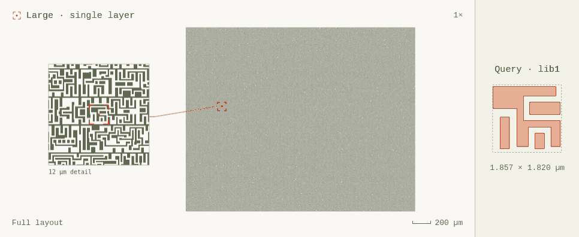
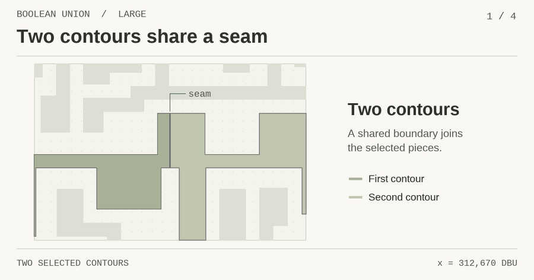

# UniMatcher

UniMatcher finds geometric patterns in Manhattan IC layouts on NVIDIA GPUs. Two overlapping rectangles can contain a spurious vertical edge where they meet. UniMatcher removes such interior boundaries by Boolean union, then searches the resulting signed edges using the same refitted linear bounding volume hierarchy (LBVH). A match reports the pattern's marker window in integer layout coordinates.

The C++17 SDK exposes Boolean normalization, exact and constrained fuzzy matching, fixed-window verification and window XOR. The repository includes a precompiled CUDA library, TXT and GDSII reader sources, and the 2023 and 2024 EDA Elite Challenge benchmarks used in Tables I and II of the paper.

## From a full layout to an exact match

The 2023 EDA Elite Challenge Large layout contains 1,996,024 polygons. Follow the red brackets from the full layer down to one occurrence of `lib1` in its original orientation (R0). The four polygons inside the marker match the template shown beside the layout. The marker spans (394380, 1142762) to (396237, 1144582) in database units. [Official reference windows](benchmarks/eda2023/public_case/answer/large/lib1_exact.txt)



The second animation uses two crops from the same layout. In the first, two contours share a vertical seam. Their signed edges point in opposite directions, and material covers both sides, so Boolean union removes the seam. In the second crop, three edges have the sign and length of the template’s 590-unit anchor. Each proposes a window. Only window A matches all 13 interior signed edges and the occupancy along the left border.



## Build and run

Use Linux x86-64, CMake 3.16 or newer, and a C++17 compiler with OpenMP support and GNU libstdc++ (GCC 11 or newer is recommended). The shared library needs `libgomp.so.1`, `GLIBCXX_3.4.29` and `CXXABI_1.3.13`. GPU execution requires an NVIDIA driver compatible with CUDA 12.3. The CUDA runtime is linked into the library, so the SDK builds with a host C++ compiler alone.

```sh
cmake -S . -B build -DCMAKE_BUILD_TYPE=Release -DUNIMATCHER_TEST_GPU=ON
cmake --build build --parallel
(cd build && ctest --output-on-failure)
./build/unimatcher-gds examples/data/overlap.gds examples/data/rectangle.gds
```

The example uses the paper's parallel GDSII reader and signed-edge extractor. It unions two overlapping rectangles on layer 1/0 and matches a template with a marker on layer 2/0. It prints one line, `10 10 18 18`, the lower-left and upper-right corners of the matching marker. On a CPU-only build host, omit `-DUNIMATCHER_TEST_GPU=ON` to run just the reader tests. [GDSII example source](examples/match_gds.cpp)

## Reproduce the public benchmarks

Run both competitions' Small cases with Python 3.6+ and its standard `lzma` module. The script decodes each bundled layout into a temporary directory, runs the GPU matcher, and checks the output against the organizers' references.

```sh
python3 benchmarks/check.py --binary build/unimatcher-contest --case small
python3 benchmarks/check.py --binary build/unimatcher-contest --case all
```

| Dataset | Included inputs | What the check compares |
| --- | --- | --- |
| 2023 single layer | Small, Large and Hidden, each with three pattern libraries | Marker lists for the original orientation and for all eight rotations/reflections. The bracketed alternate contours in `lib3` specify allowed edge motion. |
| 2024 multilayer | Small (two templates), Large and Hidden (three templates each) | Marker windows, erroneous layers and their XOR polygons. A reported window matches at least three layers under one orientation and differs on at least one. A full match under any permitted orientation excludes the window. |

For individual inputs, `build/unimatcher-contest --help` lists both CLI forms. The 2023 runner takes an output directory and can reuse one layout index across multiple pattern files. The 2024 runner takes an output filename and one multilayer pattern library. Supply a new output path in both cases. The contest runners use a compact TXT reader and a direct index on pre-normalized contest geometry. The raw GDSII example above includes normalization. The paper's industrial workloads are a separate evaluation. [Case paths, checksums, judges and dataset terms](benchmarks/README.md)

## Use the library

A downstream CMake project can place the checkout at `third_party/UniMatcher` and link two targets.

```cmake
add_subdirectory(third_party/UniMatcher)
target_link_libraries(my_matcher PRIVATE UniMatcher::core UniMatcher::io)
```

Read geometry on the host, then keep one GPU index per layout layer for subsequent templates. This example searches one 2023 fixed template in its original orientation.

```cpp
#include <unimatcher/core.hpp>
#include <unimatcher/io/signed_edges.hpp>
#include <unimatcher/io/txt.hpp>

namespace io = unimatcher::io;

auto layout = io::read_layout_txt("small.txt");
auto raw = io::to_signed_edges(layout.layers.at(0).polygons);
unimatcher::Index index(raw.edges, raw.polygon_xmax);

auto patterns = io::read_patterns_txt("lib1.txt");
const auto& shape = patterns.at(0);
auto geometry = io::to_signed_edges(shape.layers.at(0));
auto query = unimatcher::prepare_pattern(geometry.edges, io::to_box(shape.marker), false);
auto hits_by_orientation = index.match(query);
```

| Operation | API and input contract |
| --- | --- |
| Normalize and build a layout index | `Index(raw, owner_xmax)` accepts signed vertical edges and the owning polygon's rightmost x for every edge. `Index::from_canonical` accepts already-unioned, maximal boundary segments. |
| Search | `prepare_pattern` compiles an exact template. `prepare_fuzzy_pattern` accepts nominal and alternate contours with corresponding vertices. Global search requires a complete fixed interior anchor in each requested orientation. |
| Verify a position or inspect differences | `verify_windows` checks one template orientation at supplied windows. `xor_windows` returns local signed difference edges grouped by window. |
| Run a competition from C++ | `run_contest_2023` and `run_contest_2024` accept file paths and a CUDA device ordinal. The default device is 0. |

The template marker provides a common coordinate frame for every participating layer. Fuzzy matching supports topology-preserving motion with unambiguous edge correspondence. [Core API](include/unimatcher/core.hpp) · [Contest API](include/unimatcher/contest.hpp)

## Input formats

- **TXT** reads unlabelled 2023 layouts, bracketed alternate contours, and 2024 files with named layers, multiple templates and markers. `to_fuzzy_contours` preserves vertex correspondence for the fuzzy compiler. [TXT reader](io/txt/) · [Geometry adapters](include/unimatcher/io/signed_edges.hpp)
- **GDSII** reads one flat cell's BOUNDARY elements. Select geometry and marker layers by layer/datatype. The reader retains integer database units and returns their size in nanometers. Read layout and template with the same units. A selected polygon containing a diagonal edge is skipped and counted in the reader statistics. [GDSII API](include/unimatcher/io/gds.hpp)

### Parallel GDSII input from Table IV

The industrial reader maps a flat GDSII file once and scans its record headers once for all requested layers. OpenMP workers filter and decode selected datatype-0 boundaries into per-layer polygon arrays in file order. The extractor counts vertical edges per polygon, takes a prefix sum and writes into disjoint output ranges. Each layout edge carries its sign and its owning polygon's rightmost x, ready for the bounded GPU union. [Parallel reader](io/gds/parallel_reader.cpp) · [Edge extraction](io/signed_edges.cpp)

```cpp
#include <unimatcher/core.hpp>
#include <unimatcher/io/gds.hpp>
#include <unimatcher/io/signed_edges.hpp>

namespace io = unimatcher::io;
const auto layout = io::read_gds_multi("layout.gds", {1, 46, 48}, 64);
const auto raw = io::extract_signed_edges(layout.layers.at(46), 64);
unimatcher::Index index(raw.edges, raw.polygon_xmax);
```

The paper uses 64 host threads for layouts and one for templates. To read a template with its marker on layer 5000, use `read_gds_multi(path, layers, 1, 5000)`. For template preparation, `extract_signed_edges(polygons, 1, false)` returns the edges without allocating the owner bounds. Requested empty layers remain accessible. Per-layer counts, including `raw_vertical_edges` and `discarded_diagonal_polygons`, are available in `layer_counts`. Use `read_gds(path, options)` to select a nonzero datatype. [GDSII API](include/unimatcher/io/gds.hpp) · [Extraction API](include/unimatcher/io/signed_edges.hpp)

On the paper's Case1 layout, the SDK and archived Table IV code produced identical SHA-256 digests for the ordered vertices, polygon offsets, boxes, winding, signed edges and per-edge owner bounds. The 64-thread check covered 38,820,601 polygons and 122,552,269 vertical edges.

For hierarchical GDSII or PATH elements, the optional KLayout helper flattens the selected top cell to polygon boundaries. It preserves layer/datatype and the layout DBU.

```sh
python3 -m pip install klayout
python3 io/gds/flatten.py design.gds flat.gds --top TOP
```

## GPU architecture coverage

The Linux x86-64 library was built with CUDA 12.3. It contains native device code for all 14 of that toolkit's numeric SM targets, plus `compute_50` PTX for forward JIT on compatible newer NVIDIA devices.

| Device code | Targets |
| --- | --- |
| Native SASS | `sm_50`, `sm_52`, `sm_53`, `sm_60`, `sm_61`, `sm_62`, `sm_70`, `sm_72`, `sm_75`, `sm_80`, `sm_86`, `sm_87`, `sm_89`, `sm_90` |
| PTX | Compute capability 5.0 and later, with a driver able to JIT the bundled PTX |

On a GeForce RTX 4090 (SM 8.9, driver 545.23.08), the native and forced-PTX paths passed the core and GDSII tests, and the contest outputs matched the bundled references. On an RTX PRO 6000 Blackwell Server Edition (SM 12.0, driver 610.43.02), the same shared library passed the GPU regression tests, all nine 2023 D4 tasks and all three 2024 multilayer tasks. Blackwell uses the embedded PTX. The first complete contest call on an empty driver cache took 6.03 s after explicit CUDA initialization, including first-use compilation. Subsequent processes could reuse the disk cache. The host binary targets x86-64 and GNU libstdc++. [NVIDIA PTX compatibility](https://docs.nvidia.com/cuda/archive/12.3.0/cuda-c-programming-guide/index.html#ptx-compatibility)

## Repository layout

```text
include/unimatcher/   Public C++ interfaces and geometry adapters
lib/linux-x86_64/     Precompiled CUDA operator library
io/{txt,gds}/         Host readers and optional GDSII flattening tool
apps/                 Contest CLI
examples/             GDSII matching example and two small layouts
benchmarks/           Contest layouts, patterns, references and check runner
tests/                I/O and GPU regression tests
cmake/                CMake import for the binary library
docs/figures/         Animated layout examples
LICENSES/             Binary terms and third-party notices
```

## Paper and licensing

*UniMatcher: GPU-Accelerated Engine Unifying Normalization and Pattern Matching for Industrial Layout Verification*. Working draft.

The public SDK sources and examples use the MIT license. The compiled library may be used and redistributed unmodified with its notices. Contest materials retain their year-specific terms. [MIT license](LICENSE) · [License scope](LICENSES/README.md) · [Dataset notices](benchmarks/README.md)
